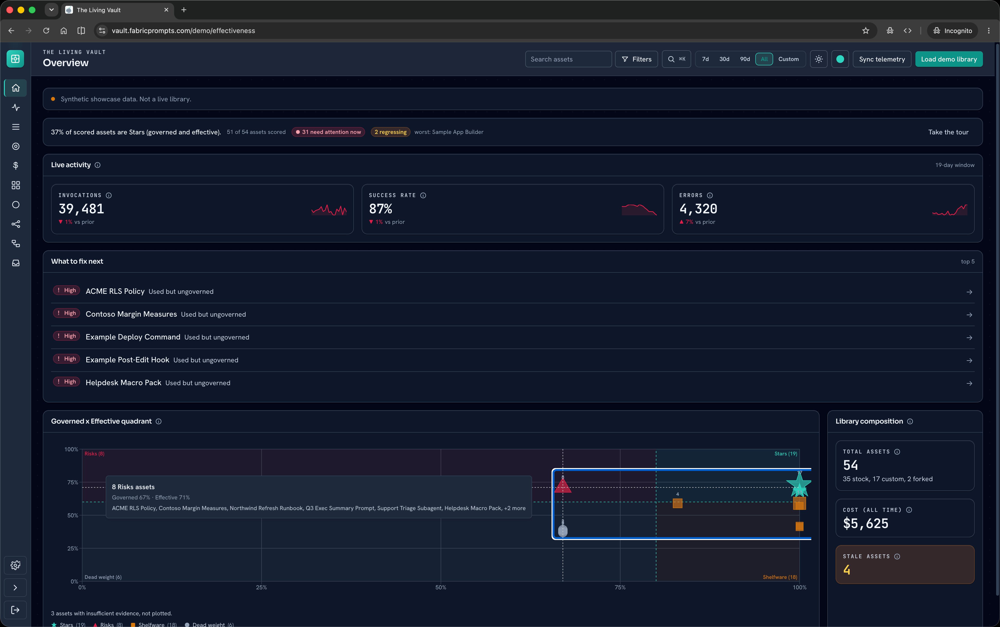
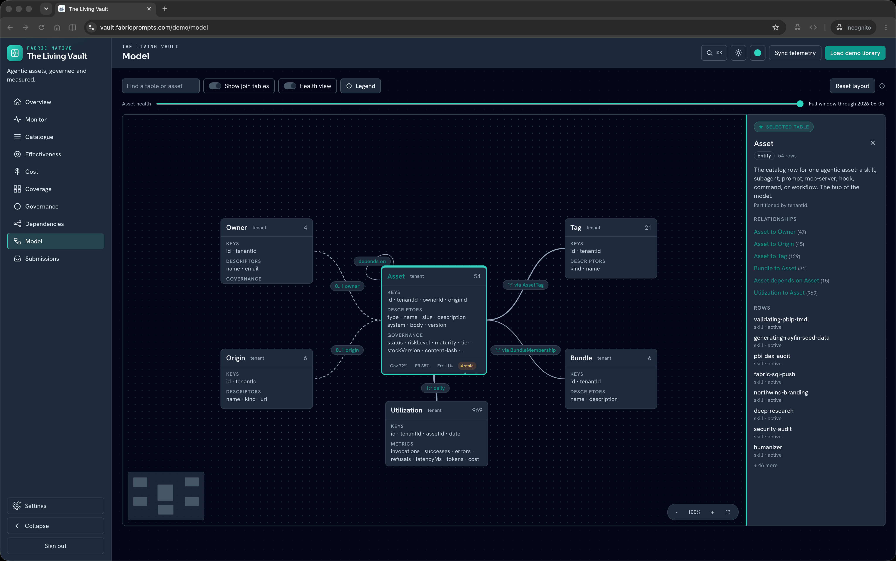
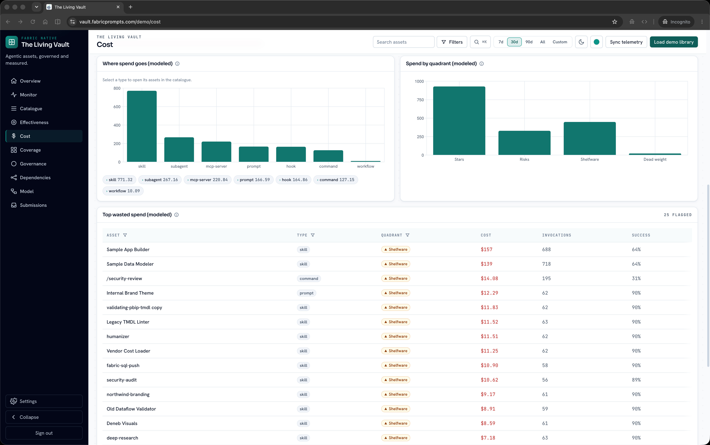

# The Living Vault

[](https://github.com/cdrguru/living-vault/actions/workflows/ci.yml)
[](LICENSE)

A local-first system of record and effectiveness monitor for your agentic
assets: skills, subagents, MCP servers, and bundles. Point it at your own
`~/.claude`, and every asset you have built carries evidence of use, cost,
measured effectiveness, and governance, so the best assets improve and the
stale ones retire, with your usage data never leaving your machine. The full
privacy contract lives in [docs/PRIVACY.md](docs/PRIVACY.md).

Built with React 19, Vite, and Tailwind on a Microsoft Fabric-native data
model (TypeScript entity decorators). Runs entirely on deterministic seed
data out of the box; wire your own data with the bundled collector.



## Quickstart

```bash
git clone https://github.com/cdrguru/living-vault.git
cd living-vault
npm ci
npm run dev        # local UI on synthetic seed data
```

Open the printed localhost URL. Everything you see is generated demo data.

## Measure your own token capital

The standalone collector scans your machine locally and writes JSON you can
upload on the Settings page (browser-only; nothing leaves your machine):

```bash
node scripts/living-vault-collect.mjs assets      # your skills/agents/commands -> projection JSON
node scripts/living-vault-collect.mjs telemetry   # your Claude Code usage -> upload JSON
```

Collectors record metadata only, never message or command content. See
[docs/PRIVACY.md](docs/PRIVACY.md) for the full privacy contract.

## What is inside

| Surface       | What it shows                                            |
| ------------- | -------------------------------------------------------- |
| Monitor       | Operational health, exception queue, per-harness usage   |
| Effectiveness | Ranked assets with evidence-graded confidence            |
| Cost          | Spend by harness and model, wasted-spend estimate        |
| Coverage      | Coverage matrix and duplicate clusters                   |
| /model        | Interactive entity-relationship canvas of the data model |




The architecture story lives in [docs/site/ARCHITECTURE.md](docs/site/ARCHITECTURE.md).

## Build and test

```bash
npm run lint
npm test               # public-scope Vitest suite
npm run build:swa      # full static bundle: landing at /, demo at /demo
```

## Contributing

Contributions are welcome. Start with [CONTRIBUTING.md](CONTRIBUTING.md);
the short version is: fork, branch, `npm test` green, open a PR.

This repository is a curated public export of a private upstream. Generated
files (most of `src/`) are refreshed from upstream and PRs against them are
cherry-picked back rather than merged directly; community-owned files (this
README, docs, templates) are yours. The export tooling marks which is which
in `.public-export/state.json`.

## License

MIT. See [LICENSE](LICENSE).
